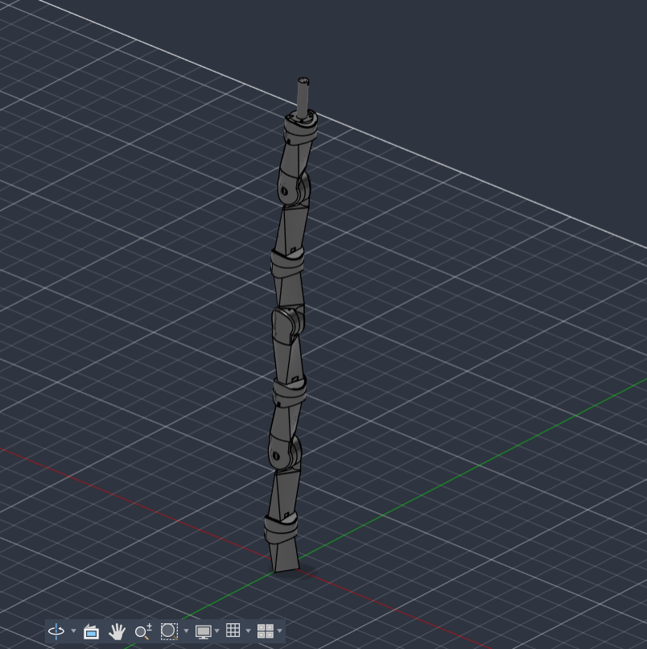
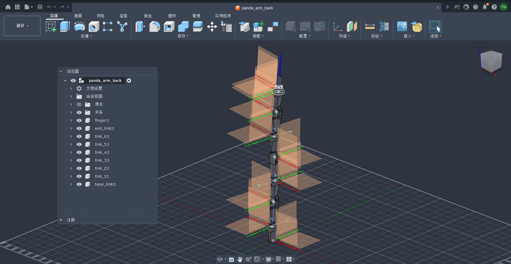
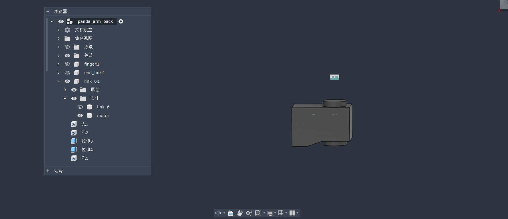
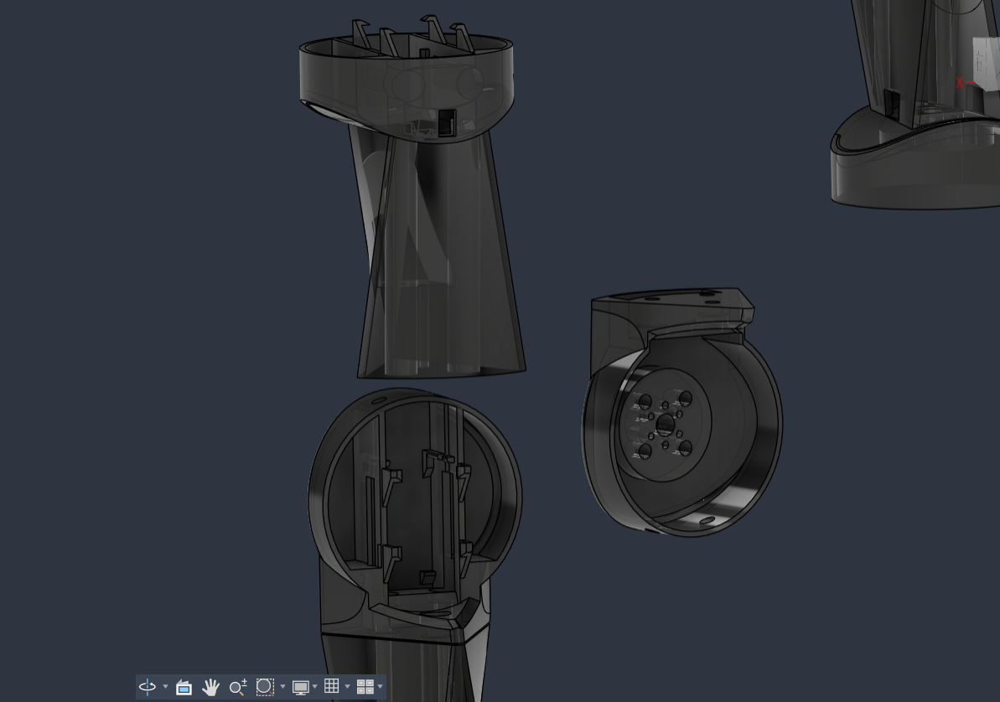

## 目录

- [项目介绍](#项目介绍)
- [文件说明](#文件说明)
- [机械臂部件清单](#机械臂部件清单)
- [电机选择](#电机选择)
- [建模说明](#建模说明)
- [一些坑](#一些坑)

## 项目介绍

- 这是一个桌面7自由度机械臂。在`https://github.com/danslovich/5DOF_Robot_Arm`提供的一个开源模型的基础上修改，使用fusion360建模，不过已导出`f3d`（fusion360工程源文件）和`step`（通用格式），应该可以导入其他建模软件。
- 修改内容：原项目使用fusion360建模，使用xl330电机，是5自由度机械臂，有行星轮结构。本项目使用宇树的J288数字电机，改为7自由度，去掉了行星轮结构，且对原本的模型进行部分修改调整，并增加了多个螺丝孔。
- 建模中部分结构并不合理。1、比如关节上有多余的螺孔。2、电机安装后不易取下。3、有些连杆模型为了拧螺丝方便做了修改但是复制到其他连杆的时候复制错对象了，修改没有同步到其他连杆。这些不太影响实际使用，所以我并没有优化。
- 在直立状态下关节旋转轴从基座向上按照 `z-y-z-y-z-y-z` 排列，和moveit教学中的panda机械臂旋转抽排列相同。

## 文件说明

- `model`里是`f3d`（fusion360工程源文件）和`step`（通用格式），用于导入建模软件。材料清单也在此目录下，内容和README的清单相同。
- `panda_arm_description/panda_arm_description`是用 fusion360 的插件自动导出的ros2模型文件，连杆名称和transmission标签由自己根据需要修改。
- 模型是包含电机的整体。如果需要去掉电机用于3d打印可手动删去组件-实体中的"motor"。如果需要单独的电机模型可用电机实体单独创建组件。材料密度根据需根据自己测量结果修改。具体界面README的“建模说明”。

## 机械臂部件清单

### 参数清单  

| 部件 | 质量(g)（带一根导线） | 体积(mm^3) | 等效密度(g/mm^3) |
| --- | --- | --- | --- |
| base_link | 43.569 | 36587.504394 | 0.0011908163926902 |
| link_1 | 77.534 | 62498.285917 | 0.0012405780232592 |
| link_2 | 69.821 | 56574.197775 | 0.00123414918365583 |
| link_3 | 77.455 | 62136.918207 | 0.00124652142776006 |
| link_4 | 68.303 | 56640.004162 | 0.00120591445941003 |
| link_5 | 76.883 | 62498.277203 | 0.00123016190910794 |
| link_6 | 69.281 | 56490.379085 | 0.0012264212264491 |
| end_link | 15.754 | 14127.698953 | 0.00111511436168129 |
| finger | 9.063 | 7427.821017 | 0.00122014248583233 |
| 电机 | 39.048 | 15311.128237 | 0.00255030193696888 |
| 一根线 | 3.363 | | |
| M1圆柱销 | 0.52 | | |
| M4长螺丝 | 2.662 | | |
| M4短螺丝 | 3.493 | | |
| M2螺丝 | 0.264 | | |

- 注：外壳使用tepg材料3d打印获得，由于3d打印并非实心而是用网状结构，且连杆上有螺丝和导线，所以需要重新称重使用等效密度。表格中质量使用0.001精度电子秤获得，体积在建模软件中直接获得。
- 给连杆设置材料密度时保留 6 位小数：0.001190、0.001240、0.001234、0.001246、0.001205、0.001230、0.001226、0.001115、0.001220（对应 base_link 至 finger）

### 价格清单（全部从淘宝获得，包括打印）  

| 零件 | 价格(人民币，元) |
| --- | --- |
| 宇树J288数字无刷电机 x 7 | 599 元/个 |
| 配套的总线串口转USB转接板 | 99 元/个 |
| PETG 材料打印外壳 | 共 240 元 |
| M1.9*12 圆柱销钉 x 14 | 12.61 元/100 个 |
| M4*45 尖尾自攻螺丝 x 14 | 2.15 元/20 个 |
| M4*20 平尾螺丝 x 7 | 忘了 |
| M2*12 平尾机牙螺丝 x 28 | 3.33 元/100 个 |
| 普通螺丝刀 | 忘了 |
| 镊子 | 忘了 |
| 2.0x150mm 超长一字螺丝刀 | 11.8 元/个 |
| 开关电源（24V，20.8A） | 117.77 元/个 |
| 开关电源线（1.5 米、三插线） | 9.5 元/个 |
| 电源线 U 型头 x 5 | 1.5 元/10 个 |

- 共 4690.66 元

## 电机选择

- xl330和J288/S288尺寸一致，机械臂模型可以不用改尺寸直接替换电机。xl330价格和S288接近，输出扭矩接近，都使用自定义总线协议，S288电机199元。但xl330是三环串联的电机，只能实现位控。J288/S288 是带前馈力矩的力位混合控制，表达式： 
$$
\tau = \tau_{\text{ff}} + k_p \cdot (p_{\text{des}} - p) + k_d \cdot (\omega_{\text{des}} - \omega)
$$

符号说明：

1. 前馈力矩：$\tau_{\text{ff}}$；
2. 期望角度位置：$p_{\text{des}}$；
3. 期望角速度：$\omega_{\text{des}}$；
4. 位置刚度：$k_p$；
5. 阻尼系数：$k_d$。

- 减速比288.35：1，使用时注意转子端和输出端之间的转换
- 其他见各自官网的说明文档和示例代码。

## 建模说明

整体结构：

| 整体装配 | 带自身坐标系 |
| :---: | :---: |
|  |  |

关节细节：

| 电机实体 | 关节连接处局部细节 |
| :---: | :---: |
|  |  |

- 左图来自 fusion360 浏览器树，可以看到 `link_6` 组件里有两个实体 `motor` 和 `link_6`，鼠标拖动实体可以移出组件，对实体右键出现菜单可以选择创建新的组件。
- 右图为关节连接处局部细节，圆形部件（关节）有两种，一种可以嵌入电机，另一种通过螺丝和电机舵盘连接。圆形部件上方的两个孔作用是让螺丝刀通过。
- 连杆固定螺丝的方法：连杆侧面有小矩形开口，用镊子夹住M2的螺丝，用超长一字螺丝刀从上方拧螺丝。
- 建模中部分螺孔没有实际作用（见项目介绍），不影响装配。

## 一些坑

- 使用 fusion360 从实体创建组件的时候坐标系会自动出现在全局坐标原点，而不是在实体上。需要手动把组件的坐标系挪到关节对应的位置，不然导出urdf文件时连杆会到处乱飞。这是因为从建模软件导出urdf文件时，实体自己的坐标系原点对应的是urdf文件中`joint`标签的`origin`，实体的质心对应的是`link`标签的`origin`。
- 惯性矩阵指的是相对质心的惯性矩阵。
- fusion360 中组件命名需要符合插件的要求才能成功导出urdf模型。
- J288质量官网标注35g是标注错误，实际上是39g。
- 自带的连接电机的导线不长，经过较长的连杆时长度勉强够，绕Z轴旋转的关节限位大概在-140°~140°
- 输出端大概0.03Nm的力矩即可驱动裸电机的舵盘转动，但是设置参数的时候需要设置大速度小阻尼或者小位移大刚度，比如Δp=0.03rad，kp=1.5；Δw=1.5rad/s，kd=0.03。如果设置成小速度大阻尼或者大位移小刚度，比如Δp=14rad，kp=0.03 或 Δw=0.03rad/s，kd=14,舵盘无法转动。
- 电机使用的是单圈绝对位置编码器，每次断电之后不能够储存之前旋转的圈数。机械0位置附近有概率识别成350多度，所以需要先归一化：
    ```
    #include <angles/angles.h>
    joint_positions_[i] = angles::normalize_angle(feedback.output_pos - zero_offset_[i]);
    ```
    然后再零位置校准。
- kp应该根据每次向电机下发指令的位置误差区间和希望输出的力矩推算，kd从极小缓慢增大到不抖动即可。


## 开源协议

- 本项目采用 [Apache License 2.0](LICENSE) 授权。
- 本项目是在 [danslovich/5DOF_Robot_Arm](https://github.com/danslovich/5DOF_Robot_Arm) 的基础上修改而来的衍生作品。
- 原项目未声明开源协议，其版权归原作者所有；本项目协议仅覆盖作者所做的修改与新增内容，包括连杆和关节构造修改，7 自由度结构改动、J288/S288 电机适配、新增安装孔位、ROS 2 描述包及相关文档。

